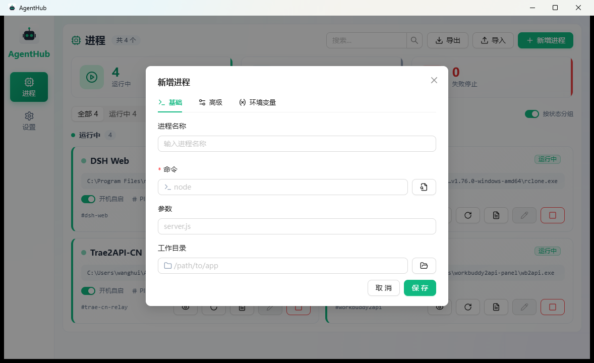

[English](#agenthub) | [中文](README.zh-CN.md)

# AgentHub

AgentHub is a local toolbox for agent-driven workflows, built with Wails, Go, and Vue 3 + TypeScript. It hosts local agent tools as long-running services and brings start/stop, logs, auto-start, and status together in one desktop window.

## Screenshot


### Process Management


Add, remove, start, stop, and restart processes with auto-start and restart policies, plus real-time monitoring of PID, restart count, and errors.

| Add Process | Edit Process | Process Logs |
|:-----------:|:------------:|:------------:|
|  |  |  |

### Advanced Settings & Environment Variables

Configure auto-start, restart policy, max retries, and custom environment variables when adding a process.

| Advanced Settings | Environment Variables |
|:-----------------:|:---------------------:|
|  |  |

### Settings Page

Theme, language, auto-start on boot, version update, and about are managed on the settings page.


## Features

### Process Management
- **Add/Remove Processes**: Easily add new processes with customizable commands, arguments, and environment variables
- **Start/Stop/Restart**: Full control over process lifecycle with graceful shutdown support
- **Auto-start**: Configure processes to start automatically when the application launches
- **Restart Policies**: Support for `always`, `on_failure`, and `never` restart policies
- **Process Monitoring**: Real-time status monitoring with PID, restart count, and error tracking
- **Import/Export**: Export process configurations as JSON and import them on another device; review the file first and choose whether same-name processes are skipped or overwritten

### Cross-Platform Support
- **Windows** (amd64)
- **macOS** (Intel and Apple Silicon)
- **Linux** (amd64, arm64)

### Auto-start on Boot
- **macOS**: Uses LaunchAgent
- **Linux**: Uses XDG Autostart
- **Windows**: Uses Registry

### Logging
- Rolling log files with configurable retention
- Real-time log streaming
- Separate stdout/stderr capture

### CLI

AgentHub ships with a command line interface in the same executable. Running the
binary without a known subcommand starts the GUI as usual; passing a subcommand
runs the CLI, which talks to the running app through a local control endpoint
(port and token are published to `auth.json` in the data directory on startup).

```bash
# Create a `agenthub` command pointing at the installed app (macOS)
make cli

agenthub process list                       # list all processes
agenthub process start <id>                 # start a process
agenthub process stop <id>                  # stop a process
agenthub process logs <id> --tail 200       # show the last 200 log lines
agenthub process logs <id> --follow         # stream new log lines
agenthub config get                         # show settings
agenthub config set theme light|dark        # set the light/dark theme
agenthub config set language zh|en          # set the UI language
agenthub config set autostart on|off        # toggle auto-start on boot
agenthub config set autostart-wsl on|off    # toggle auto-starting WSL on boot
agenthub wsl status                         # show WSL runtime status
agenthub wsl start                          # start WSL
agenthub wsl stop                           # stop WSL
agenthub wsl restart                        # restart WSL
agenthub status                             # show app status
agenthub version                            # show the version
```

Process log files are stored under the data directory (`<dataDir>/<logDir>/<id>`),
so `logs` also works while the GUI is open.

`autostart-wsl` only controls whether WSL is started automatically at boot. It is
independent from the app's own auto-start setting and does not affect the manual
`wsl start` / `wsl stop` commands.

## Build

### Prerequisites

- Go 1.23.0 or higher
- Node.js 18+ and npm
- [Wails CLI](https://wails.io/docs/gettingstarted/installation)

### Development

```bash
# Install frontend dependencies
cd frontend && npm install && cd ..

# Install Go dependencies
go mod download

# Run in development mode
wails dev
```

### Production Build

```bash
# Build for current platform
wails build

# The built application will be in build/bin directory
```


## 💬 Join the Community

> Add friend with note "AgentHub"

| WeChat Group | QQ Group |
|:------------:|:--------:|
|  |  |

## License

This project is licensed under the [Apache 2.0 License](LICENSE).

