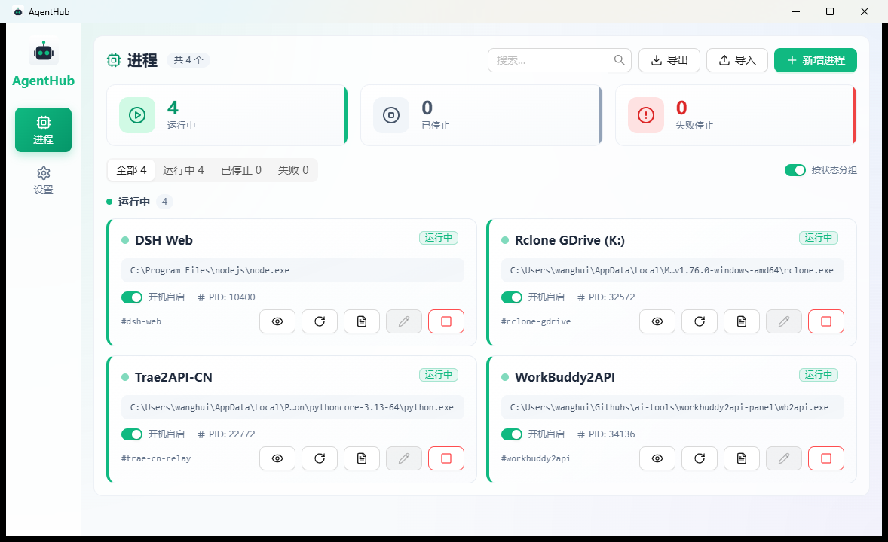
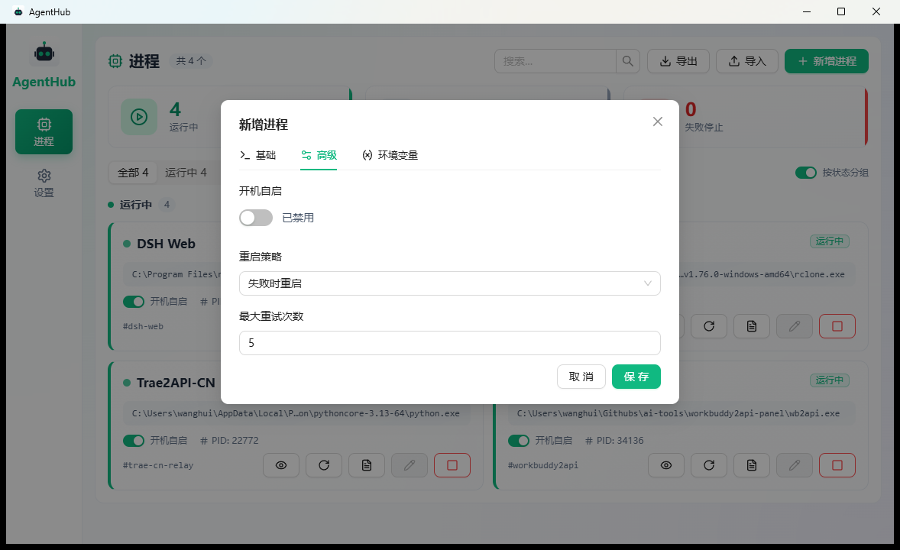
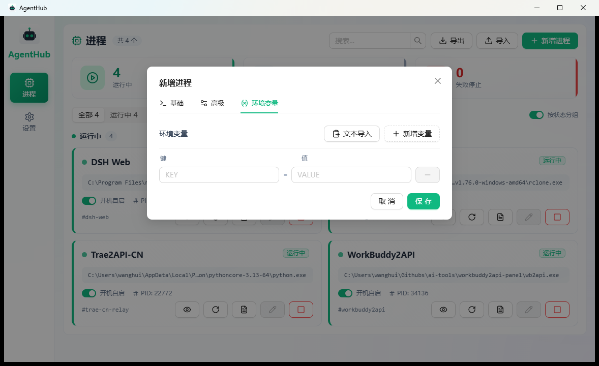
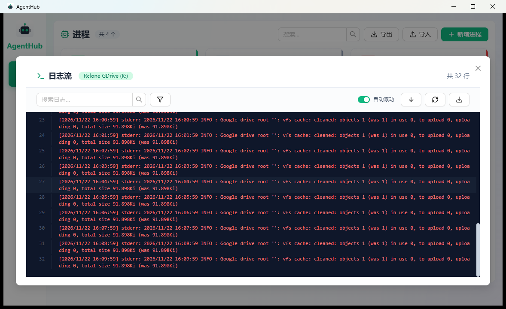
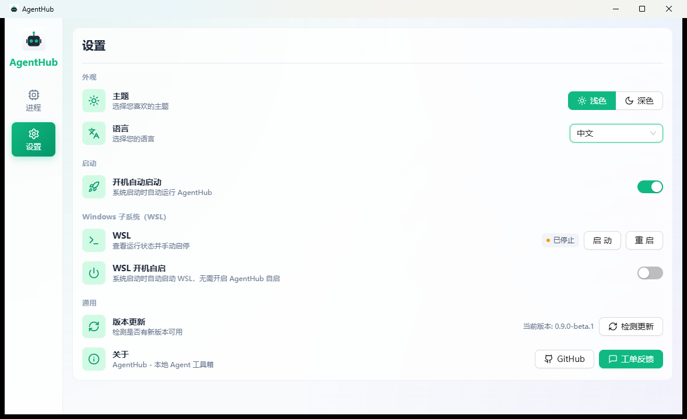
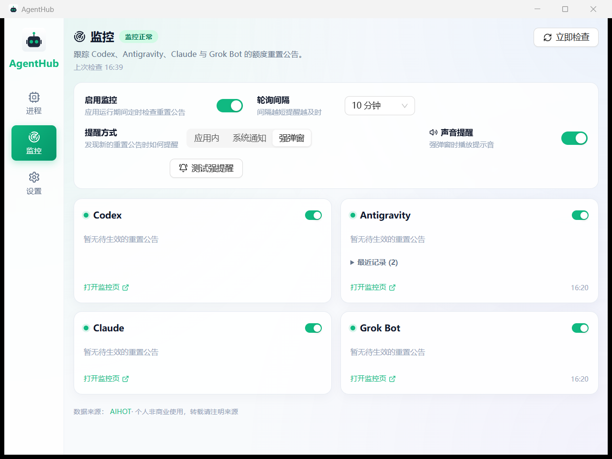

[English](#agenthub) | [中文](README.zh-CN.md)

# AgentHub

AgentHub is a local toolbox for agent-driven workflows, built with Wails, Go, and Vue 3 + TypeScript. It hosts local agent tools as long-running services and brings start/stop, logs, auto-start, and status together in one desktop window.

## Screenshots

### Process Management



See service status, PID, and restart count, and start, stop, restart, inspect logs, or edit configuration in place.

### Add Process

Basic configuration, advanced restart policy, and environment variables live in three tabs.

| Basic | Advanced | Environment |
|:-----:|:--------:|:-----------:|
|  |  |  |

### Logs and Settings

| Live Logs | Settings |
|:---------:|:--------:|
|  |  |

### Reset Monitor



Follow any subset of the four products, tune the polling interval and alert mode, and jump to the AIHOT page for each announcement.

## Highlights

- **Service hosting**: register local agent tools as long-running services and manage start, stop, restart, and status in one place
- **Reset monitor**: watch AIHOT reset announcements for Codex, Antigravity, Claude and Grok Bot, and get notified when a reset is announced
- **Quota tracking**: weekly pools for Gemini Web, Antigravity, Grok and Grok Bot with time-vs-usage pacing, burn rate, estimated exhaustion and threshold alerts
- **Restart without downtime**: closing AgentHub does not kill running children; the next launch re-adopts them by PID instead of spawning duplicates
- **Centralized logs**: child stdout/stderr is written to durable log files and streamed into the UI in real time
- **Failure recovery**: restart policies for always, on-failure, and never, with a configurable retry limit
- **Portable configuration**: export all process definitions as JSON and import them on another machine
- **CLI control**: the same executable ships a CLI for scripting start/stop, logs, and settings

## Features

### Process Management
- **Add/Remove Processes**: custom command, arguments, working directory, and environment variables
- **Start/Stop/Restart**: full control over process lifecycle with graceful shutdown support
- **Auto-start**: configure processes to start automatically when the application launches
- **Restart Policies**: support for `always`, `on_failure`, and `never` restart policies
- **Process Monitoring**: real-time status monitoring with PID, restart count, error tracking, and working-set memory sampled on manual refresh
- **Import/Export**: export process configurations as JSON; review a file before importing and choose whether same-name processes are skipped or overwritten

### Reset Monitor
- **Model selection**: follow any subset of Codex, Antigravity, Claude and Grok Bot
- **Polling**: checks the AIHOT JSON API every 10 minutes by default (5–120 minutes configurable), with ETag caching
- **Alert modes**: in-app badge, system notification, or a strong modal that stays on top until acknowledged or snoozed for 10 minutes
- **No duplicates**: announcements are deduplicated per model and event, including across restarts
- **Test alert**: verifies the notification, sound and modal path without waiting for a real announcement

The monitor reads [AIHOT](https://aihot.news/resets). AIHOT data is free for personal,
non-commercial use with attribution; commercial use requires authorization from AIHOT.

### Quota Tracking
- **One weekly view**: Gemini Web, Antigravity (Gemini / Claude+GPT / Argon groups), Grok and Grok Bot weekly pools in a single list; 5-hour pools are deliberately hidden
- **Pacing bar**: green shows usage within the elapsed week, amber hatch marks room to spend faster, red hatch marks usage ahead of the clock, grey is what remains
- **Local sources only**: reads a local `gemini-web2api-go` service, a local `Antigravity-Manager` API, and the `GrokUsagePet` snapshot; AgentHub never stores Google or xAI credentials
- **History and alerts**: per-pool samples drive burn rate and estimated exhaustion; alerts at 80/90/100%; failed polls keep the previous values marked `stale`
- **Deployment guide**: see [docs/deploy/quota-sources.md](docs/deploy/quota-sources.md) for what to install and how to wire each source

### Cross-Platform Support
- **Windows** (amd64)
- **macOS** (Intel and Apple Silicon)
- **Linux** (amd64, arm64)

### Auto-start on Boot
- **macOS**: Uses LaunchAgent
- **Linux**: Uses XDG Autostart
- **Windows**: Uses Registry

### Logging
- Rolling log files with configurable retention
- Real-time log streaming with search, error filtering, and download
- Separate stdout/stderr capture

## CLI

AgentHub ships with a command line interface in the same executable. Running the
binary without a known subcommand starts the GUI as usual; passing a subcommand
runs the CLI, which talks to the running app through a local control endpoint
(port and token are published to `auth.json` in the data directory on startup).

```bash
# Create a `agenthub` command pointing at the installed app (macOS)
make cli

agenthub process list                       # list all processes
agenthub process start <id>                 # start a process
agenthub process stop <id>                  # stop a process
agenthub process logs <id> --tail 200       # show the last 200 log lines
agenthub process logs <id> --follow         # stream new log lines
agenthub config get                         # show settings
agenthub config set theme light|dark        # set the light/dark theme
agenthub config set language zh|en          # set the UI language
agenthub config set autostart on|off        # toggle auto-start on boot
agenthub config set autostart-wsl on|off    # toggle auto-starting WSL on boot
agenthub wsl status                         # show WSL runtime status
agenthub wsl start                          # start WSL
agenthub wsl stop                           # stop WSL
agenthub wsl restart                        # restart WSL
agenthub status                             # show app status
agenthub version                            # show the version
```

Process log files are stored under the data directory (`<dataDir>/<logDir>/<id>`),
so `logs` also works while the GUI is open.

`autostart-wsl` only controls whether WSL is started automatically at boot. It is
independent from the app's own auto-start setting and does not affect the manual
`wsl start` / `wsl stop` commands.

## Build

### Prerequisites

- Go 1.23.0 or higher
- Node.js 18+ and npm
- [Wails CLI](https://wails.io/docs/gettingstarted/installation)

### Development

```bash
# Install frontend dependencies
cd frontend && npm install && cd ..

# Install Go dependencies
go mod download

# Run in development mode
wails dev
```

### Production Build

```bash
# Build for current platform
wails build

# The built application will be in build/bin directory
```

Icons are generated from the geometry of the frontend SVG by
[scripts/gen-icons.py](scripts/gen-icons.py) (PNG / ICO / ICNS plus tray icons).
Run `python scripts/gen-icons.py` after changing the logo to refresh every asset.

## Fork & Acknowledgements

This project is a fork of [modstart-lib/prochub](https://github.com/modstart-lib/prochub)
(formerly ProcHub). Thanks to the original authors and the upstream project for
the foundation this work builds on.

This fork adds rebranding, a repositioning as an agent toolbox, process adoption
across restarts, durable log files, and new icon assets. The copyright and
license notices of the upstream project and its dependencies remain in effect.
See [NOTICE](NOTICE) for the statement of changes and [LICENSE](LICENSE) for the
full license text.

## License

This project is licensed under the [Apache 2.0 License](LICENSE).
