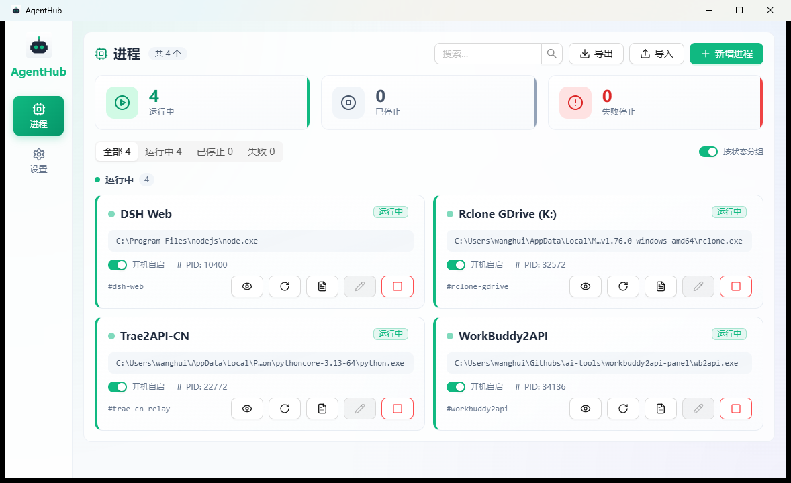
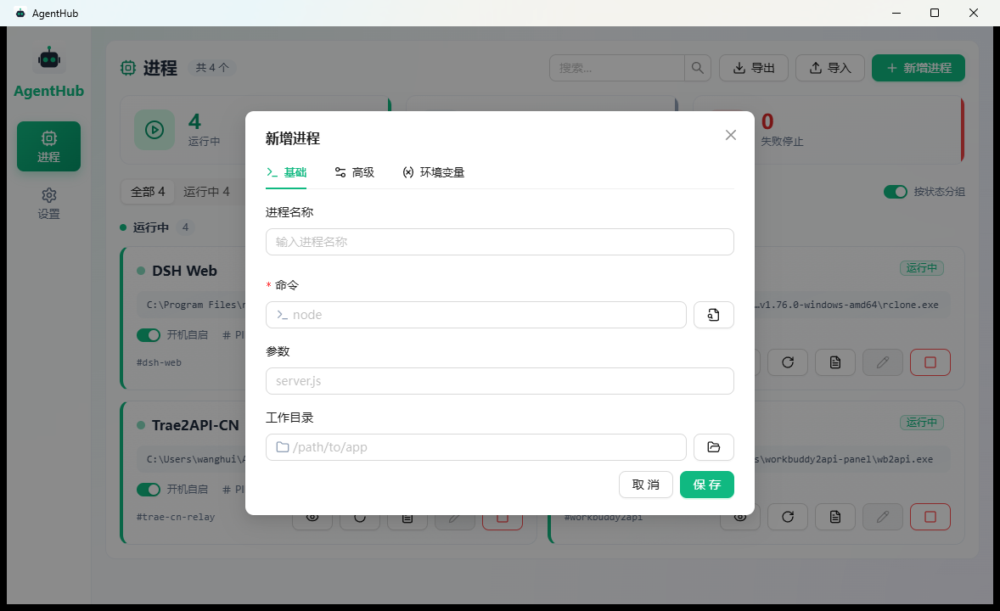
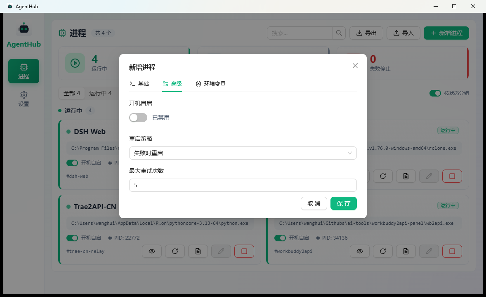
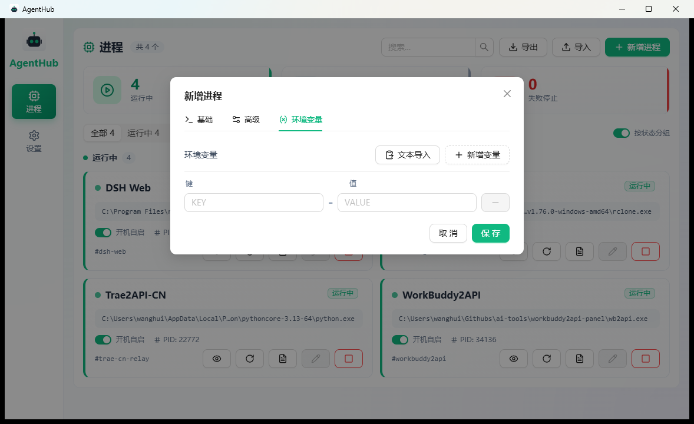
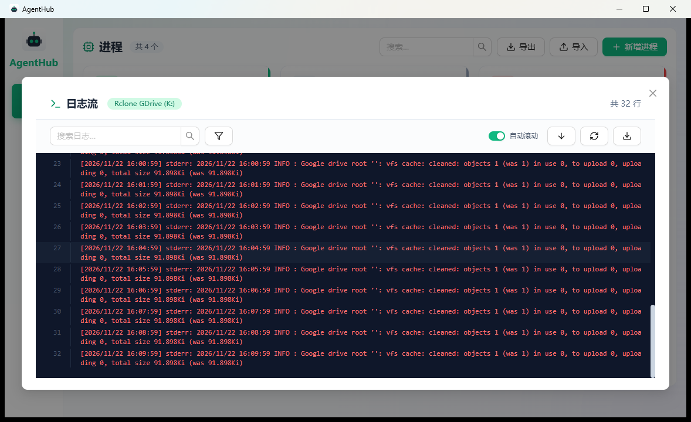
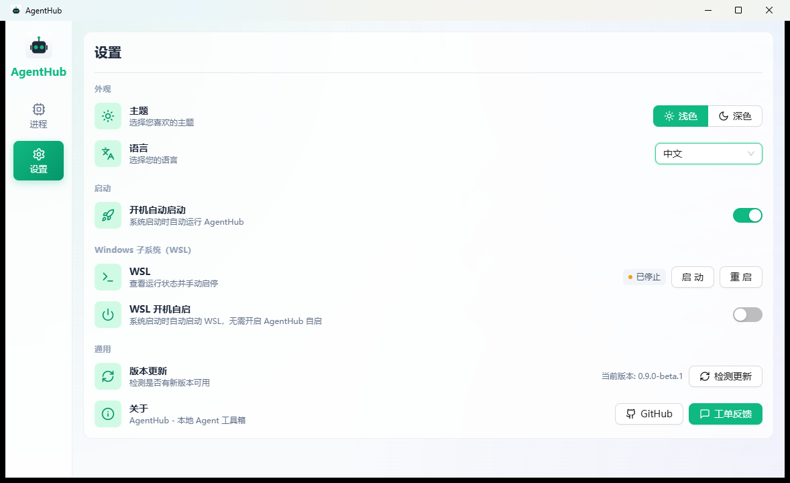
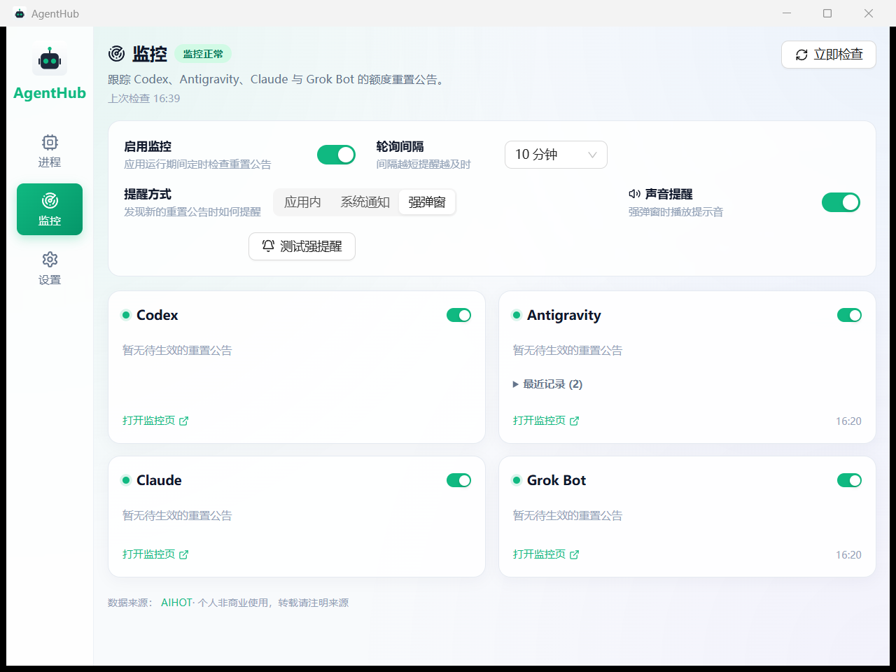

[English](README.md) | [中文](#agenthub)

# AgentHub

AgentHub 是一个 Agent 主导的本地工具箱合集，使用 Wails、Go 和 Vue 3 + TypeScript 构建。它以常驻服务的形式托管本地的 Agent 工具，把启动、停止、日志、开机自启和运行状态集中在一个桌面窗口里管理。

## 界面预览

### 进程管理



统一查看服务状态、PID 与重启次数，并可直接启动、停止、重启、查看日志或编辑配置。

### 新增进程

支持基础配置、高级重启策略与环境变量三个标签页。

| 基础配置 | 高级设置 | 环境变量 |
|:--------:|:--------:|:--------:|
|  |  |  |

### 日志与设置

| 实时日志 | 设置页 |
|:--------:|:------:|
|  |  |

### 额度重置监控



可分别关注四个模型，调整轮询间隔与提醒方式，并直接跳转到 AIHOT 查看公告原文。

## 核心能力

- **常驻服务托管**：把 Agent 工具注册为常驻服务，统一管理启动、停止、重启和运行状态
- **额度重置监控**：跟踪 AIHOT 上 Codex、Antigravity、Claude、Grok Bot 的重置公告，宣布重置时第一时间提醒
- **退出不中断服务**：关闭 AgentHub 不会终止正在运行的子进程，再次启动时会按 PID 接管这些服务，不会重复拉起
- **日志集中查看**：子进程的 stdout/stderr 写入持久化日志文件，界面实时跟随输出
- **失败恢复**：支持始终重启、失败重启、从不重启三种策略，并可限制最大重试次数
- **配置迁移**：进程配置可导出为 JSON，在另一台设备导入还原
- **命令行控制**：同一可执行文件内置 CLI，可脚本化地启停服务、查看日志和修改设置

## 功能特性

### 进程管理

- **添加/删除进程**：自定义命令、参数、工作目录和环境变量
- **启动/停止/重启**：完整的进程生命周期控制，支持优雅关闭
- **自动启动**：配置进程在应用启动时自动运行
- **重启策略**：支持 `always`（始终）、`on_failure`（失败时）和 `never`（从不）重启策略
- **进程监控**：实时状态监控，包括 PID、重启次数和错误追踪
- **导入/导出**：导出全部进程配置为 JSON；导入前可预览内容，同名进程可选择跳过或覆盖

### 额度重置监控

- **模型关注**：可在 Codex、Antigravity、Claude、Grok Bot 中任选需要关注的模型
- **定时轮询**：默认每 10 分钟请求一次 AIHOT JSON API（可配置 5–120 分钟），带 ETag 缓存
- **提醒方式**：应用内红点、系统通知，或置顶强弹窗；强弹窗必须「我知道了」或「稍后提醒（10 分钟）」
- **不重复提醒**：按模型与事件去重，重启应用后也不会重复通知
- **测试提醒**：无需等待真实公告即可验证通知、声音与弹窗链路

数据来源为 [AIHOT](https://aihot.news/resets)。AIHOT 数据面向个人非商业用途免费，
使用时需标注来源；商业用途需取得 AIHOT 授权。

### 跨平台支持

- **Windows** (amd64)
- **macOS** (Intel 和 Apple Silicon)
- **Linux** (amd64, arm64)

### 开机自启

- **macOS**：使用 LaunchAgent
- **Linux**：使用 XDG Autostart
- **Windows**：使用注册表

### 日志功能

- 滚动日志文件，支持可配置的保留策略
- 实时日志流，可搜索、筛选错误、下载
- 分离的 stdout/stderr 捕获

## 命令行工具

AgentHub 在同一可执行文件中内置了命令行工具：不带子命令启动时照常打开界面，带子命令时执行 CLI，并通过本地控制接口与运行中的应用通信（启动时会把端口与令牌写入数据目录的 `auth.json`）。

```bash
# 创建 agenthub 命令，指向已安装的应用（macOS）
make cli

agenthub process list                       # 列出全部进程
agenthub process start <id>                 # 启动进程
agenthub process stop <id>                  # 停止进程
agenthub process logs <id> --tail 200       # 查看最后 200 行日志
agenthub process logs <id> --follow         # 持续输出新增日志
agenthub config get                         # 查看当前配置
agenthub config set theme light|dark        # 设置明暗主题
agenthub config set language zh|en          # 设置界面语言
agenthub config set autostart on|off        # 设置开机自动启动
agenthub config set autostart-wsl on|off    # 设置开机时自动启动 WSL
agenthub wsl status                         # 查看 WSL 运行状态
agenthub wsl start                          # 启动 WSL
agenthub wsl stop                           # 停止 WSL
agenthub wsl restart                        # 重启 WSL
agenthub status                             # 查看运行状态
agenthub version                            # 查看版本
```

进程日志文件保存在数据目录（`<dataDir>/<logDir>/<id>`），因此界面打开时也可用 `logs` 读取。

`autostart-wsl` 只控制“开机时是否自动启动 WSL”，与应用自身的开机自启设置相互独立，也不影响 `wsl start`/`wsl stop` 手动启停。

## 构建

### 环境要求

- Go 1.23.0 或更高版本
- Node.js 18+ 和 npm
- [Wails CLI](https://wails.io/docs/gettingstarted/installation)

### 开发模式

```bash
# 安装前端依赖
cd frontend && npm install && cd ..

# 安装 Go 依赖
go mod download

# 运行开发模式
wails dev
```

### 生产构建

```bash
# 为当前平台构建
wails build

# 构建的应用程序将在 build/bin 目录中
```

图标由 [scripts/gen-icons.py](scripts/gen-icons.py) 根据前端 SVG 的几何参数生成 PNG / ICO / ICNS 与托盘图标；修改 Logo 后运行 `python scripts/gen-icons.py` 即可同步全部资源。

## Fork 与致谢

本项目 fork 自 [modstart-lib/prochub](https://github.com/modstart-lib/prochub)（原 ProcHub），感谢原作者与上游项目的基础工作。

本项目在上游基础上完成了品牌更名、Agent 工具箱定位调整、进程跨重启接管、日志持久化以及全新图标等改动。上游与相关依赖的开源作者版权与许可声明仍然有效，具体的修改声明见 [NOTICE](NOTICE)，许可证全文见 [LICENSE](LICENSE)。

## 许可证

本项目采用 [Apache 2.0 许可证](LICENSE)。
